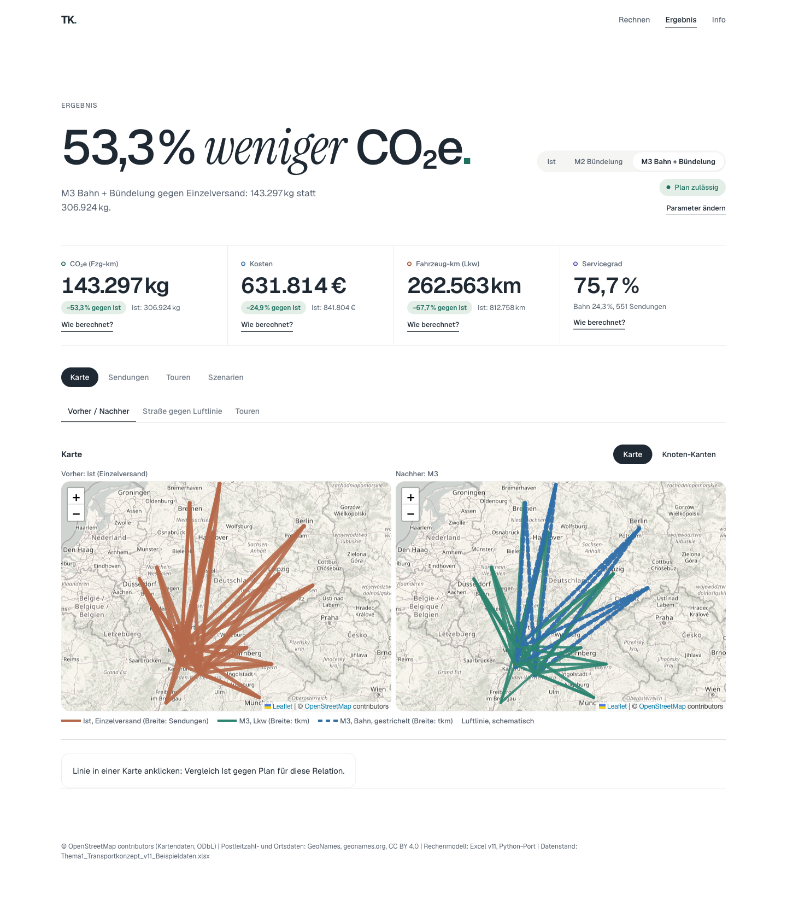
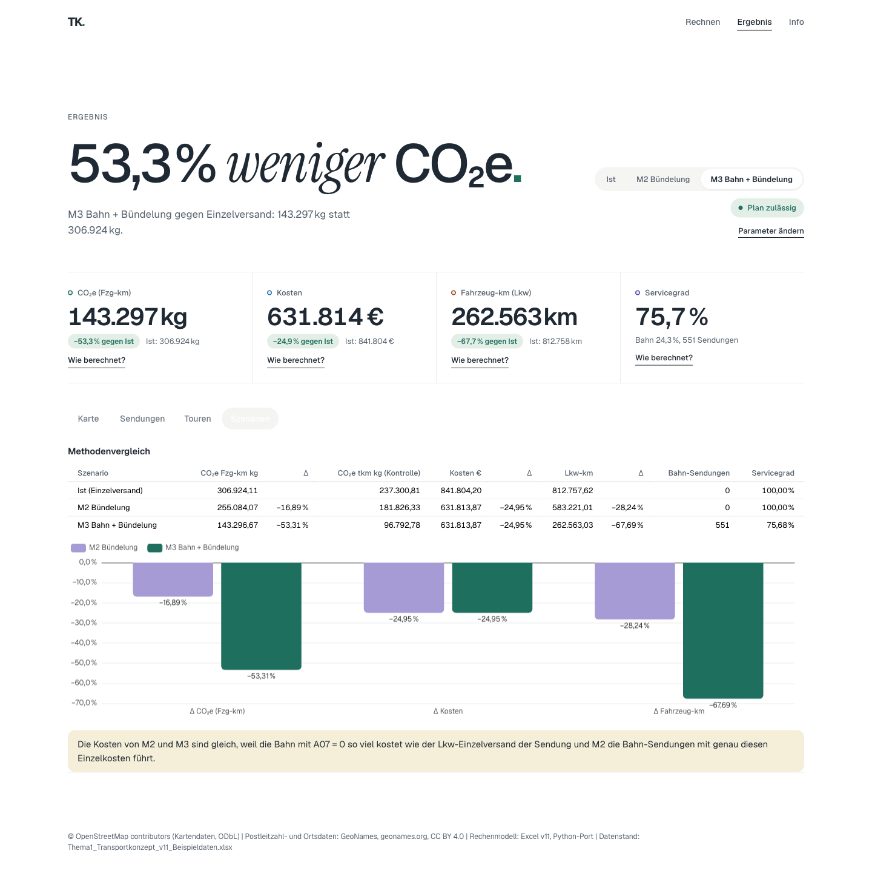
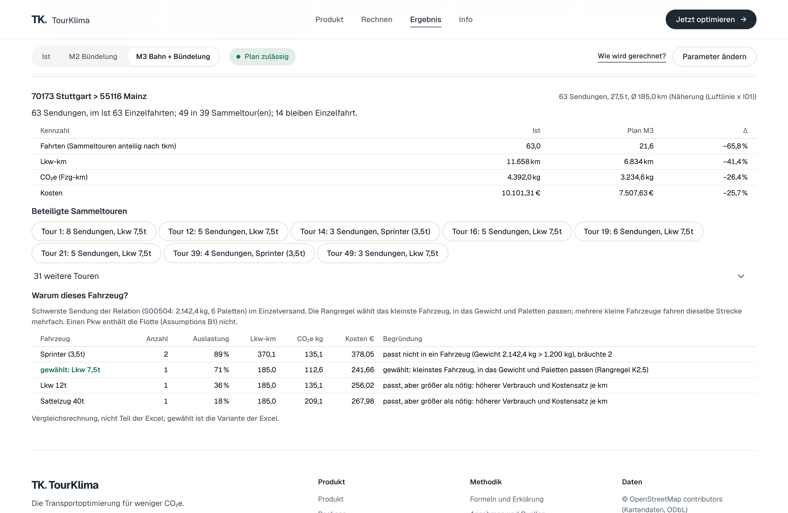
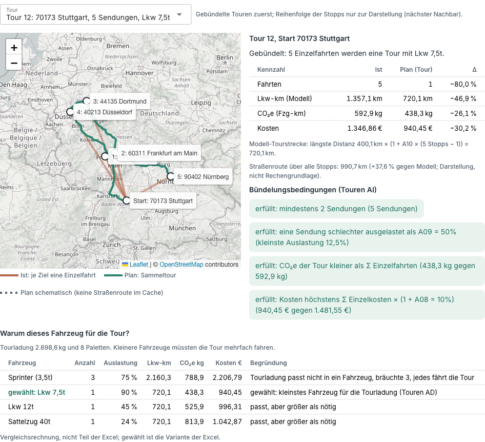
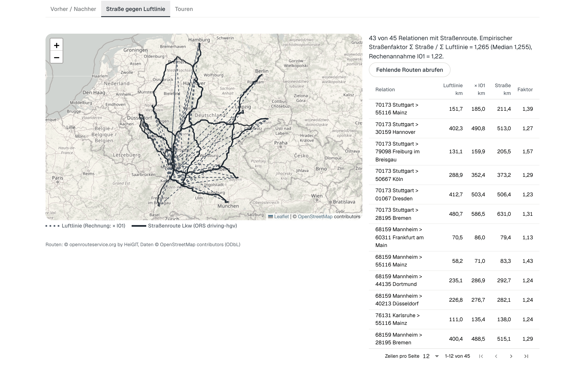
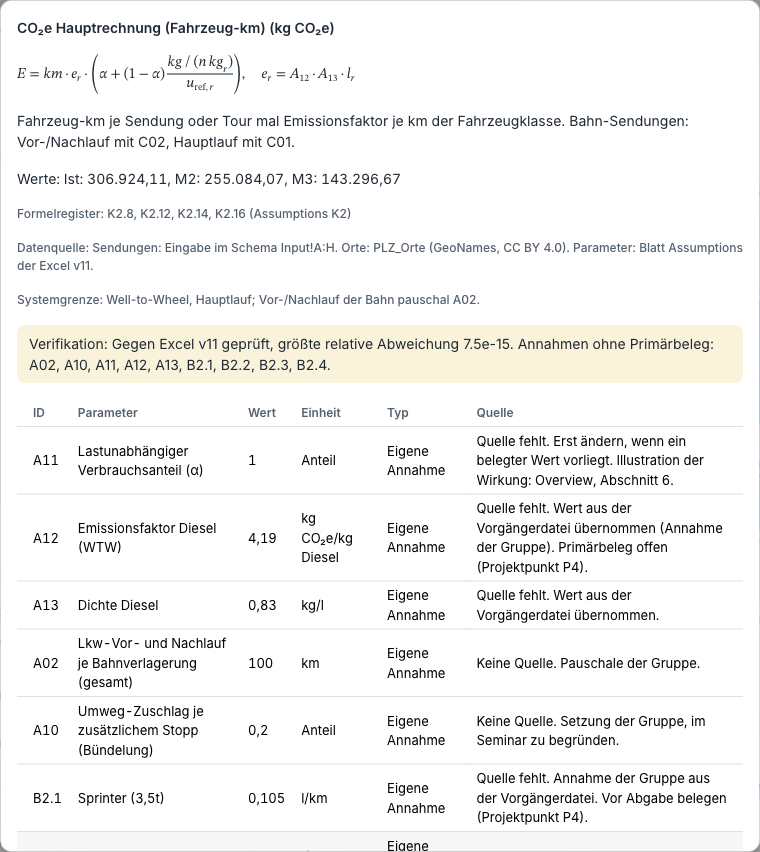
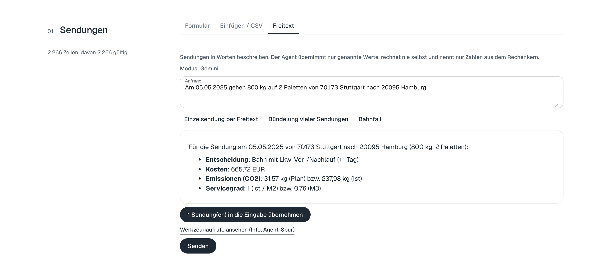

# Transportkonzept: nachhaltige Transportplanung mit Bündelung und Bahn

Weboberfläche und Python-Rechenkern für das Excel-Modell v11 "Nachhaltiges Transportkonzept" (Seminar Planungsprozesse BLO513/WPML733, HWG Ludwigshafen). Die App rechnet drei Szenarien, zeigt sie auf der Karte und erklärt jede Zahl. Die Excel ist maßgeblich: Kennzahlen und alle 2.266 Sendungen stimmen auf 1e-9 überein.



| Szenario | Was passiert | CO₂e | Kosten | Lkw-km | Servicegrad |
|---|---|---:|---:|---:|---:|
| Ist | jede Sendung einzeln im kleinsten passenden Fahrzeug | 306.924 kg | 841.804 € | 812.758 km | 100 % |
| M2 Bündelung | Sendungen je Tag und Startort zu Touren (Next-Fit) | −16,9 % | −24,9 % | −28,2 % | 100 % |
| M3 Bahn + Bündelung | erst Bahnprüfung, dann Bündelung der Lkw-Sendungen | −53,3 % | −24,9 % | −67,7 % | 75,7 % |

Werte der Beispieldaten (2.266 Sendungen, 3 Startorte, 15 Zielorte).

## Inhalt

1. [Funktionen im Überblick](#funktionen-im-überblick)
2. [Demo in acht Schritten](#demo-in-acht-schritten)
3. [Bedienung](#bedienung)
4. [Installation in unter 10 Minuten](#installation-in-unter-10-minuten)
5. [Schlüssel für Straßenrouten und Assistent](#schlüssel-für-straßenrouten-und-assistent)
6. [Wie gerechnet wird](#wie-gerechnet-wird)
7. [Aufbau und Abnahme](#aufbau-und-abnahme)
8. [Daten und Lizenzen](#daten-und-lizenzen)

## Funktionen im Überblick

| Bereich | Was die App zeigt |
|---|---|
| Szenarien | Umschalter Ist, M2, M3; Status-Chip wie das Cockpit der Excel ("Plan zulässig") |
| Karte Vorher/Nachher | Luftlinien je Relation, Breite nach Sendungen bzw. tkm, Bahn gestrichelt |
| Relationsdetail | Klick auf eine Linie: Ist gegen Plan, beteiligte Sammeltouren, "Warum dieses Fahrzeug?" |
| Touren | Einzelfahrten als Stern gegen die Sammeltour mit Stopps, vier Bündelungsbedingungen mit Werten |
| Straße gegen Luftlinie | echte Lkw-Routen (OpenRouteService) neben der Luftlinie, km-Vergleich, gemessener Straßenfaktor |
| Kennzahlen | CO₂e, Kosten, Lkw-km, Servicegrad mit Delta und "Wie berechnet?" (Formel, Parameter, Quelle) |
| Eingabe | Formular, Einfügen aus Excel, CSV/XLSX, Freitext über den Assistenten |
| Parameter | A01, A02, A05, A08, A09, A10, I01, A04 mit Sofortberechnung; Variante "Straßen-km" |
| Prüfungen | die 20 Prüfungen der Excel und ein Abgleich Python gegen Excel je Kennzahl |
| Export | CSV und XLSX im Schema Input!A:H für den Rückweg in die Excel |

## Demo in acht Schritten

### 1. Ausgangslage: Einzelversand (Ist)

Umschalter auf **Ist**. Jede Sendung fährt einzeln: 2.266 Fahrten, 306.924 kg CO₂e. Die Linien sind Luftlinien zwischen PLZ-Schwerpunkten (schematisch), die Breite zeigt die Zahl der Sendungen.

### 2. Bündelung (M2) und Bahn (M3)

**M2 Bündelung** fasst Sendungen desselben Tages und Startorts zu Touren zusammen: 428 Touren, davon 318 gebündelt. **M3 Bahn + Bündelung** verlagert zusätzlich 551 Sendungen über 500 km auf die Bahn (gestrichelt). Zielkonflikt: Servicegrad 75,7 %, weil die Bahn einen Tag länger braucht.



### 3. Eine Relation anklicken: was wurde optimiert?

Klick auf die Linie **Stuttgart > Mainz**: 63 Sendungen, im Ist 63 Einzelfahrten; im Plan fahren 49 in Sammeltouren, 14 bleiben einzeln. CO₂e −26,4 %, Kosten −25,7 %.



### 4. Warum dieses Fahrzeug und nicht mehrere kleine?

Unter dem Relationsdetail rechnet die Tabelle alle vier Fahrzeugklassen für die schwerste Sendung durch. Die Rangregel der Excel wählt das kleinste Fahrzeug, in das Gewicht und Paletten passen. Mehrere kleine Fahrzeuge fahren dieselbe Strecke mehrfach: Für Tour 12 bräuchte es 3 Sprinter mit 788,9 kg CO₂e statt eines Lkw 7,5t mit 438,3 kg. Einen Pkw enthält die Flotte nicht; das kleinste Fahrzeug ist der Sprinter 3,5t.

### 5. Tour im Detail

Klick auf **Tour 12** (oder auf eine Zeile im Tab Touren): Die fünf Einzelfahrten ab Stuttgart erscheinen als Stern, die Sammeltour als Lkw-Route über fünf Stopps. Rechts: aus 5 Fahrten wird 1, CO₂e −26,1 %, Kosten −30,2 %, dazu die vier Bedingungen der Excel mit den echten Werten. Die Straßenroute ist mit 990,7 km um 37,6 % länger als die Modellannahme (längste Distanz mit Umwegzuschlag 720,1 km); sie dient der Einordnung, nicht der Rechnung.



### 6. Straße gegen Luftlinie

Die Rechnung nutzt wie die Excel Luftlinie × 1,22. Der Tab **Straße gegen Luftlinie** zeigt die echten Lkw-Routen von OpenRouteService daneben und berechnet den Straßenfaktor aus den Routen: über 43 Relationen 1,265 (Median 1,255), also etwas mehr als die Annahme I01 = 1,22. Für Freiburg kennt das Lkw-Netz von ORS keine Route; dort zeigt die Karte die Pkw-Route und kennzeichnet sie. Mit dem Schalter **Variante: Distanz aus Straßenrouten** rechnet die App alle Szenarien mit Straßen-km (Quelle "Relationstabelle", wie in der Excel vorgesehen).



### 7. Wie berechnet? Und stimmt das mit der Excel?

**Wie berechnet?** an jeder Kennzahl zeigt Formel, Parameter mit Quelle und Belegstand sowie die Abweichung zur Excel. Die Seite **Info**, Tab **Prüfungen**, enthält die 20 Prüfungen der Excel und den Abgleich je Kennzahl.



### 8. Freitext mit dem Assistenten

Im Tab **Freitext** eine Sendung in Worten beschreiben. Der Assistent übernimmt nur genannte Werte, ruft den Rechenkern auf und nennt nur Zahlen aus den Werkzeugausgaben. Jede andere Zahl wird verworfen; eine Aufforderung zum Schätzen lehnt er ab. Die Agent-Spur (Seite **Info**) zeigt jeden Werkzeugaufruf.



## Bedienung

| Ich möchte | So geht es |
|---|---|
| eigene Sendungen rechnen | Eingabe, Tab **Einfügen / CSV**: Zeilen aus Excel (Spalten A bis H wie Blatt Input) einfügen, "Ersetzen" wählen, **Übernehmen**. Oder CSV/XLSX hochladen |
| eine einzelne Sendung prüfen | Tab **Formular**: Datum, Start, Ziel, Gewicht; beim Verlassen des Feldes zeigt die App die Ortszuordnung |
| Parameter testen | Parameterpanel: Wert ändern, die App rechnet sofort neu; **Zurücksetzen** stellt die Werte aus Assumptions wieder her |
| Ergebnisse je Sendung sehen | Seite **Ergebnis**, Tab **Sendungen**, Filter nach Verkehrsträger oder Tour; Spalte Ergebnis entspricht Input!BD |
| eine Tour verstehen | Seite **Ergebnis**, Tab **Touren**, Zeile anklicken: die Tour öffnet sich im Tab **Karte** |
| zurück in die Excel | **Export CSV** oder **Export XLSX**, Spalten A bis H in Input!A14 einfügen; für die Variante Straßen-km zusätzlich **Relationstabelle** in PLZ_Orte R:T |
| Daten der Excel wiederherstellen | **Beispieldaten laden** |

Fehlerhafte Zeilen rechnen nicht mit; die Meldung entspricht Spalte I der Excel ("Ziel nicht gefunden", "Gewicht ≤ 0" und weitere).

## Installation in unter 10 Minuten

Voraussetzungen: macOS, Linux oder Windows, Internet für die Installation, die Excel-Mappe der Gruppe.

```bash
# 1. uv installieren (lädt Python 3.12 selbst)
curl -LsSf https://astral.sh/uv/install.sh | sh          # macOS, Linux
# Windows (PowerShell): powershell -ExecutionPolicy ByPass -c "irm https://astral.sh/uv/install.ps1 | iex"

# 2. Projekt holen und Pakete installieren
git clone https://github.com/wnk8/Transportoptimierung.git
cd Transportoptimierung
uv sync

# 3. Excel-Mappen nach data/excel kopieren (werden nicht versioniert)
#    Thema1_Transportkonzept_v11_Beispieldaten.xlsx (Pflicht)
#    Thema1_Transportkonzept_v11.xlsx (Vorlage, nur für den Round-Trip-Test)

# 4. Referenz erzeugen und starten
make reference
make run          # http://127.0.0.1:8080, Vorschau des Design-Systems unter /vorschau
```

Ohne `make` (etwa unter Windows): `uv run python -m tk.ui.app` mit der Umgebungsvariable `PYTHONPATH=src`; Tests mit `uv run pytest -q`.

Hinweis macOS: In synchronisierten Ordnern (etwa der Schreibtisch mit iCloud) markiert macOS die `.pth`-Datei der Installation als versteckt und Python 3.12 überspringt sie. Deshalb setzen Makefile und pytest `PYTHONPATH=src`.

## Schlüssel für Straßenrouten und Assistent

Beide Schlüssel sind kostenlos und gehören nur in die Datei `.env` (von git ausgeschlossen), nie in `.env.example`, Code oder Chat.

```bash
cp .env.example .env    # dann .env öffnen und die Werte eintragen
make routes             # Straßenrouten einmalig abrufen (etwa 10 Minuten), danach offline
```

| Schlüssel | Woher | Wofür |
|---|---|---|
| `ORS_API_KEY` | Konto bei openrouteservice.org, Dashboard, neuer Token (Plan Standard) | Straßenrouten für alle Relationen und Touren (Lkw-Profil `driving-hgv`) |
| `GEMINI_API_KEY` | aistudio.google.com, "Get API key" | Assistent im Tab Freitext; ohne Schlüssel läuft der Demo-Modus mit drei aufgezeichneten Fällen |
| `GEMINI_MODEL` | optional | Standard `gemini-flash-lite-latest` |

Die kostenlose Gemini-Stufe darf Eingaben zur Produktverbesserung nutzen: nur Testdaten eingeben. Die Demo läuft lokal, nicht als öffentliche Instanz.

## Wie gerechnet wird

Die Formeln sind die Zellformeln der Excel (Formelregister Assumptions K2); Details, Quellen und Belegstand in [docs/Annahmen.md](docs/Annahmen.md).

| Schritt | Regel |
|---|---|
| Distanz | Eingabe, sonst Relationstabelle, sonst Luftlinie der PLZ-Schwerpunkte × I01 (1,22) |
| Fahrzeug | Paletten = Eingabe oder Gewicht / 268 kg; kleinstes Fahrzeug, in das Gewicht und Paletten passen; sonst mehrere des größten |
| CO₂e | Hauptrechnung: Fahrzeug-km × kg CO₂e/km × Lastfaktor; Kontrolle: tkm × GLEC-Faktor |
| Bahn (M3) | Distanz > 500 km, Zusatzlaufzeit zulässig, Kosten höchstens +10 %; Vor-/Nachlauf mit Lkw, Hauptlauf mit Bahnfaktor |
| Bündelung (M2) | Next-Fit je Tag und Startort; Tour gebündelt, wenn mindestens 2 Sendungen, eine unter 50 % ausgelastet, CO₂e sinkt und Kosten höchstens +10 % |
| Zuordnung | Tourwerte nach tkm-Anteil auf die Sendungen |
| Servicegrad | 1 − Anteil der Bahn-Sendungen (bei Zusatzlaufzeit > 0) |

## Aufbau und Abnahme

| Ordner | Inhalt |
|---|---|
| `src/tk` | Rechenkern (kennt weder Oberfläche noch Agent): Orte, Distanz, Fahrzeug, Emissionen, Kosten, Bahn, Bündelung, Szenarien, Prüfungen, Erklärung, Export |
| `src/tk/compare.py`, `src/tk/routing.py` | Vergleichsrechnungen für die Karte und Straßenrouten (OpenRouteService, Cache) |
| `src/tk/agent` | Assistent: Werkzeuge, Orchestrator mit Zahlenprüfung, Spur, Demo-Modus |
| `src/tk/ui` | Oberfläche (NiceGUI, Leaflet, ECharts) |
| `scripts` | `make_reference.py` (Referenz aus der Excel), `make_routes.py` (Straßenrouten) |
| `tests` | Abnahme gegen die Excel, Eigenschaften, Agent, Routing, Export, Kontrast, Platzhalter |
| `docs` | [Gesamtpaket](docs/Gesamtpaket.md), [Annahmen](docs/Annahmen.md), [Demo-Skript](docs/Demo_Skript.md), [Prompt-Log](docs/prompt_log.md), [Prüfprotokoll](docs/Pruefprotokoll.md) |

Abnahme: `make lint test` grün. Kennzahlen und alle Zeilen der Sendungen, Touren und Routen weichen höchstens 1e-9 von der Excel ab, die Sensitivität höchstens 1e-8; die 20 Prüfungen stimmen. Tests mit Excel-Daten werden ohne Mappe übersprungen (GitHub Actions).

## Daten und Lizenzen

Code: MIT-Lizenz (`LICENSE`). Excel-Mappen, Referenz-CSVs und Routen-Cache sind nicht im Repository.

Postleitzahl- und Ortsdaten: GeoNames, geonames.org, CC BY 4.0. Kartendaten: © OpenStreetMap contributors (ODbL). Routen: © openrouteservice.org by HeiGIT. Schrift: Inter (SIL OFL 1.1). Weitere Komponenten: [THIRD_PARTY.md](THIRD_PARTY.md).
